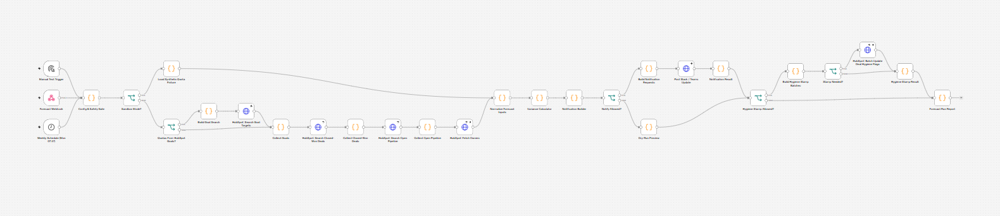

# n8n-hubspot-goal-quota-vs-actuals-variance-forecast-bot

> Reconciles rep-level quarterly quota targets against Closed-Won ARR and weighted open pipeline, computes weekly pacing variance and gap-to-quota run rates, and posts structured updates to leadership Slack / Microsoft Teams channels.

Every Monday (or on demand), this n8n workflow does the following:

1. **Reads quotas** from HubSpot **Goals** (`goal_targets`). Monthly targets are summed, and annual targets are prorated to the quarter. Alternatively, quotas can come from a `QUOTA_MAP` env variable.
2. **Reads closed-won deals** and **open pipeline** closing in the current fiscal quarter, using paginated, fail-closed CRM searches.
3. **Computes, per rep:** expected-to-date, pacing variance, attainment, gap to quota, required vs current weekly run rate, weighted pipeline, coverage, projected attainment, week-over-week deltas, and a status (`AHEAD`, `ON_TRACK`, `AT_RISK`, `CRITICAL`, `QUOTA_MET`, `NO_QUOTA` or `EARLY_QUARTER`).
4. **Posts** a Slack Block Kit message and/or a Teams Adaptive Card to leadership.
5. **Optionally flags** CRM hygiene issues that distort the forecast (past-due close dates, missing probabilities, invalid amounts, missing owners) on a custom deal property.

It is **safe by default**. Imported as-is, it runs against a synthetic fixture (portal `99000001`): zero API calls, nothing posted, zero CRM updates. Both message payloads appear in **Dry-Run Preview**.

---

## Contents

1. [Architecture overview](#1-architecture-overview)
2. [Prerequisites](#2-prerequisites)
3. [5-minute sandbox quick start](#3-5-minute-sandbox-quick-start)
4. [Step-by-step setup and go-live](#4-step-by-step-setup-and-go-live)
5. [Environment variables](#5-environment-variables)
6. [Pacing calculation logic](#6-pacing-calculation-logic)
7. [Notification format](#7-notification-format)
8. [Safety and fail-closed matrix](#8-safety-and-fail-closed-matrix)
9. [Compliance checklist](#9-compliance-checklist)
10. [Troubleshooting](#10-troubleshooting)
11. [Repository layout](#11-repository-layout)
12. [Disclaimer and license](#12-disclaimer--liability-limitation)

---

## 1. Architecture overview

```mermaid
flowchart LR
    subgraph T["Triggers"]
        MT["Manual Test Trigger"]
        WH["Forecast Webhook<br/>POST, secret"]
        SC["Weekly Schedule<br/>Mon 07:47"]
    end
    MT --> C
    WH --> C
    SC --> C
    C["Config & Safety Gate<br/>env only, fail-safe flags,<br/>fiscal quarter, as-of,<br/>webhook host allowlist"] --> SB{"Sandbox Mode?"}
    SB -- "true (default)" --> FX["Load Synthetic<br/>Quota Fixture"]
    SB -- false --> QG{"Quotas From<br/>HubSpot Goals?"}
    QG -- true --> BG["Build Goal Search"] --> HG["HubSpot: Search<br/>Goal Targets"] --> CG
    QG -- "false (QUOTA_MAP)" --> CG["Collect Goals<br/>FAIL CLOSED"]
    CG --> HW["HubSpot: Search<br/>Closed-Won Deals"] --> CW["Collect Closed-Won<br/>FAIL CLOSED"]
    CW --> HP["HubSpot: Search<br/>Open Pipeline"] --> CP["Collect Open Pipeline<br/>FAIL CLOSED"]
    CP --> HO["HubSpot: Fetch Owners<br/>optional names"]
    FX --> N["Normalize Forecast Inputs"]
    HO --> N
    N --> V["Variance Calculator<br/>pacing, gap, run rate,<br/>weighted pipeline, status,<br/>BigInt money, guards"]
    V --> NB["Notification Builder<br/>Slack Block Kit + Teams<br/>Adaptive Card, escaping,<br/>duplicate guard"]
    NB --> NA{"Notify Allowed?"}
    NA -- "false (default)" --> DR["Dry-Run Preview"]
    NA -- true --> BR["Build Notification<br/>Requests"] --> PS["Post Slack / Teams Update<br/>URL from $env only"] --> NR["Notification Result<br/>snapshot + posting record"]
    DR --> HA{"Hygiene Stamp Allowed?"}
    NR --> HA
    HA -- true --> BH["Build Hygiene<br/>Stamp Batches"] --> SN{"Stamp Needed?"}
    SN -- true --> BU["HubSpot: Batch Update<br/>Deal Hygiene Flags<br/>the ONLY CRM write"] --> HR["Hygiene Stamp Result"]
    SN -- false --> HR
    HA -- false --> RP
    HR --> RP["Forecast Run Report"]
```





### Design principles

| Principle | Implementation |
|---|---|
| **Fail closed on data** | A failed search page, more than 10,000 matches (HubSpot's search ceiling) or truncated pagination **stops the run**. A forecast built on partial data would mislead leadership. |
| **Fail closed on posting** | Posting is blocked if no quota matched, if invalid records exceed `MAX_INVALID_RECORD_PCT`, or on config errors. The duplicate-post guard skips a quarter + as-of date that has already been posted. |
| **Exact arithmetic** | Money is BigInt minor units with half-up rounding, and thresholds are compared as exact fractions. A rep at exactly 100.0% pacing is never misclassified by floating-point drift. |
| **Secrets stay in `$env`** | Webhook URLs are credentials: the HTTP node reads them from `$env` directly, and only "is set / host allowed" booleans reach item data. Hosts must match `NOTIFY_ALLOWED_HOST_SUFFIXES` and use `https`. |
| **Escaping** | CRM-sourced names are escaped for Slack (`<!channel>` can never become a mention) and stripped of markdown for Teams. |
| **One CRM write node** | Only *HubSpot: Batch Update Deal Hygiene Flags* writes. Everything else is a search or a GET. |

---

## 2. Prerequisites

- **n8n** 1.x or later, with `N8N_BLOCK_ENV_ACCESS_IN_NODE=false`. If env access is blocked, the workflow falls back to sandbox defaults. Verified on n8n 2.47.7.
- **Node.js 18+** to run the offline simulator. It has no dependencies.
- A **HubSpot private app** in a developer test account or sandbox portal first.
- **Quotas** as HubSpot **Goals** (for example a "Sales Quota" goal per rep, with monthly, quarterly or annual targets), **or** a `QUOTA_MAP` env variable.
- A **Slack incoming webhook** and/or a **Microsoft Teams Workflows webhook**, each pointing to a **private** leadership channel.

### HubSpot private app scopes

| Scope | Used for |
|---|---|
| `crm.objects.goals.read` | `POST /crm/v3/objects/goal_targets/search` (quotas). Not needed with `QUOTA_SOURCE=env`. |
| `crm.objects.deals.read` | Closed-won and open-pipeline deal searches |
| `crm.objects.owners.read` | Optional: rep display names (`GET /crm/v3/owners`). Without it, reps are labelled by owner ID. |
| `crm.objects.deals.write` | Optional: hygiene flags (`POST /crm/v3/objects/deals/batch/update`), only with `HUBSPOT_MUTATIONS_ENABLED=true` |

### HubSpot properties used

| Property | Object | Notes |
|---|---|---|
| `hs_target_amount`, `hs_start_datetime`, `hs_end_datetime`, `hs_goal_name`, `hubspot_owner_id` | goal_targets | One record per time slice. A monthly goal has 12 records; they are summed for the quarter. |
| `amount_in_home_currency` (or `AMOUNT_PROPERTY`) | deals | HubSpot's amount converted to the portal's home currency. It falls back to `amount` when the deal is already in home currency. |
| `hs_deal_stage_probability` | deals | Weighting when `PROBABILITY_SOURCE=hubspot`. |
| `hs_is_closed_won`, `hs_is_closed`, `closedate`, `pipeline`, `dealstage` | deals | Search filters. |
| `forecast_hygiene_flag` (single-line text), `forecast_hygiene_checked_at` (datetime) | deals | **Create these** if you enable hygiene flags. |

### Notification endpoints

- **Slack:** create an app with an **incoming webhook** for a private leadership channel, and put the URL in `SLACK_WEBHOOK_URL`.
- **Microsoft Teams:** Office 365 Connectors are being retired. In the Teams **Workflows** app, use the template *"Post to a channel when a webhook request is received"*, and put the generated URL in `TEAMS_WEBHOOK_URL`. Workflows accepts **Adaptive Cards only**, which is the format this workflow sends.

---

## 3. 5-minute sandbox quick start

**Step 1. Run the offline simulator (about 1 second, no n8n, no network).**

```bash
git clone <your-private-copy-of-this-repo>
cd n8n-hubspot-goal-quota-vs-actuals-variance-forecast-bot
node scripts/simulate-sandbox-run.js
```

The simulator only loads `fs`, `path` and `vm`. It contains a small n8n-style engine that follows `workflow.json`'s connections, runs every Code node verbatim, evaluates expressions, emulates body and query-string pagination plus workflow static data, and routes HTTP calls to in-memory HubSpot, Slack and Teams mocks. The HubSpot mock **really evaluates the search filters**. Its 125 checks cover structure and static safety, safe defaults, fiscal-quarter derivation, webhook auth and destination allowlisting, every fixture scenario against an independent reference model, every policy option, data-quality guards, Slack and Teams payload validity and escaping, pagination, the fail-closed limits, posting, the duplicate-post guard, week-over-week snapshots and the hygiene write. It ends with:

```
✅ 125 passed, 0 failed
Sandbox team: 675000.00 / 1190986.30 USD (56.7%), pacing 113.4%, forecast 79.0%
```

`sim-output/` contains `slack-blocks.json` (paste it into Slack's Block Kit Builder), `teams-adaptive-card.json` (paste it into the Adaptive Cards Designer), a text preview and run reports.

**Step 2. Import into n8n.** Go to **Workflows → Import from File** and select `workflow.json`. No credentials are needed.

**Step 3. Execute.** Click **Test workflow**. Quarter `2026-Q4`, as of `2026-11-16`: 46 of 92 days elapsed (50%).

| Rep (synthetic) | Quota | Won | Pacing | Projected | Status |
|---|---|---|---|---|---|
| Morgan | 180,000 | 30,000 | 33.3% | 16.7% | `CRITICAL` (zero weighted pipeline, needs $22,826/wk = 5.00× current) |
| Quinn | 120,986.30 (annual 480k × 92/365) | 50,000 | 82.7% | 41.3% | `CRITICAL` (escalated by projection) |
| Riley | 200,000 | 80,000 | 80.0% | 90.0% | `AT_RISK` (one past-due deal excluded) |
| Taylor | none | 20,000 | n/a | n/a | `NO_QUOTA` |
| Jordan | 240,000 | 120,000 | 100.0% | 95.0% | `ON_TRACK` (one invalid amount excluded) |
| Avery | 300,000 (3 monthly goals) | 210,000 | 140.0% | 86.0% | `AHEAD` |
| Casey | 150,000 | 160,000 | 213.3% | 113.3% | `QUOTA_MET` |

Open **Dry-Run Preview** to see the exact Slack and Teams payloads and the reasons nothing was posted.

---

## 4. Step-by-step setup and go-live

Each stage changes one thing. Do them in a HubSpot test portal and a private test channel first.

### Stage A: live read, dry run

```bash
SANDBOX_MODE=false
HUBSPOT_ACCESS_TOKEN=<from secret store>
HUBSPOT_PORTAL_ID=<numeric test-portal ID>
GOAL_NAME_CONTAINS=quota        # must match your quota goal names
FISCAL_YEAR_START_MONTH=1
```

Restart n8n and run manually. In **Variance Calculator**, check that every rep's `quota` and `quotaParts` match the targets shown in HubSpot Goals, and reconcile `won` against a HubSpot closed-won report for the same quarter. Review `hygiene` and `dataQuality`.

### Stage B: post to a private test channel

```bash
DRY_RUN=false
NOTIFICATIONS_ENABLED=true
NOTIFY_CHANNELS=slack,teams
SLACK_WEBHOOK_URL=<from secret store>
TEAMS_WEBHOOK_URL=<from secret store>
```

Run once. The report shows `POSTED`. Run again with the same as-of date: it shows `SKIPPED_ALREADY_POSTED`, because the duplicate guard is working. Use `FORCE_REPOST=true` to post again deliberately.

### Stage C (optional): hygiene flags

Create the two custom deal properties ([§2](#2-prerequisites)), then set `HUBSPOT_MUTATIONS_ENABLED=true`. Deals that distort the forecast are tagged, for example `PAST_DUE_CLOSE_DATE` or `MISSING_PROBABILITY;PAST_DUE_CLOSE_DATE`. Unchanged flags are not rewritten.

### Stage D: schedule

Point the webhooks at the real leadership channel and activate the workflow. The **Weekly Schedule** runs on Mondays at 07:47 (instance time zone). Configure an n8n **Error Workflow** so a fail-closed abort alerts an owner.

### Webhook (optional, on demand)

```bash
curl -X POST "https://<your-n8n>/webhook/hubspot-quota-variance" \
  -H "x-forecast-secret: $WEBHOOK_SHARED_SECRET" \
  -H "content-type: application/json" \
  -d '{"as_of":"2026-11-16"}'          # optional: "quarter_start":"2026-10-01"
```

Live webhooks fail closed without a valid secret. n8n's execution history stores raw trigger input, so restrict who can view executions.

---

## 5. Environment variables

| Variable | Default | Description |
|---|---|---|
| `SANDBOX_MODE` | `true` | **Safe-ON.** Synthetic fixture and portal, zero network calls. Off only with `false`/`0`/`no`/`off`. |
| `DRY_RUN` | `true` | **Safe-ON.** Build everything, post and write nothing. |
| `NOTIFICATIONS_ENABLED` | `false` | **Safe-OFF.** Post to Slack / Teams. On only with `true`/`1`/`yes`/`on`. |
| `HUBSPOT_MUTATIONS_ENABLED` | `false` | **Safe-OFF.** Write hygiene flags. |
| `FORCE_REPOST` | `false` | Bypass the duplicate-post guard. |
| `FISCAL_YEAR_START_MONTH` | `1` | 1–12. Fiscal years are labelled by the year they end in (`FY2027-Q1`). Calendar years use `2026-Q4`. |
| `QUARTER_START_DATE` | quarter containing as-of | Must be the first day of a fiscal quarter. |
| `AS_OF_DATE` | today (UTC) | `YYYY-MM-DD`. Future dates are refused. Days **before** this date count as elapsed. |
| `QUOTA_SOURCE` | `hubspot_goals` | Or `env` (uses `QUOTA_MAP`). |
| `GOAL_NAME_CONTAINS` | `quota` | Case-insensitive goal-name filter (excludes "Calls made" and similar goals). |
| `QUOTA_MAP` | — | `ownerId:amount,…`. |
| `HOME_CURRENCY` | `USD` | Currency of quotas and `amount_in_home_currency`. |
| `AMOUNT_PROPERTY` | `amount_in_home_currency` | Deal amount property (for example `hs_arr`). |
| `PROBABILITY_SOURCE` | `hubspot` | Or `stage_map` (uses `STAGE_WEIGHTS`). |
| `STAGE_WEIGHTS` | — | `stageId:0..1,…`. |
| `WEIGHT_PAST_DUE_PIPELINE` | `false` | Include open deals whose close date has already passed. |
| `PIPELINES` | all | Optional pipeline ID allowlist. |
| `PACING_BASIS` | `calendar` | Or `business` (Mon–Fri minus `BUSINESS_HOLIDAYS`, 5-day weeks). |
| `BUSINESS_HOLIDAYS` | — | `YYYY-MM-DD,…`. |
| `PACING_AHEAD_THRESHOLD` | `1.10` | Pacing ratio at or above this is `AHEAD`. |
| `PACING_ON_TRACK_THRESHOLD` | `0.90` | At or above this is `ON_TRACK`. |
| `PACING_AT_RISK_THRESHOLD` | `0.70` | Below this is `CRITICAL`; between this and on-track is `AT_RISK`. |
| `CRITICAL_PROJECTED_ATTAINMENT` | `0.75` | Projected attainment below this escalates to `CRITICAL`. |
| `MIN_ELAPSED_FRACTION_FOR_PACING` | `0.10` | Below this, reps are `EARLY_QUARTER` (pacing is noisy). |
| `MIN_PIPELINE_COVERAGE` | `1.0` | Coverage (weighted ÷ gap) below this is flagged `LOW_COVERAGE`. |
| `INCLUDED_OWNER_IDS` / `EXCLUDED_OWNER_IDS` | — | Team scope. |
| `MAX_INVALID_RECORD_PCT` | `10` | Posting is blocked above this share of invalid deals. |
| `HUBSPOT_ACCESS_TOKEN` | — | Private app token. Required in live mode. |
| `HUBSPOT_PORTAL_ID` | — | Numeric. Required in live mode; forced to `99000001` in sandbox. |
| `HUBSPOT_API_BASE_URL` | `https://api.hubapi.com` | API host. |
| `HUBSPOT_SEARCH_PAGE_SIZE` | `200` | 10–200. |
| `HYGIENE_FLAG_PROPERTY` / `HYGIENE_CHECKED_AT_PROPERTY` | `forecast_hygiene_flag` / `forecast_hygiene_checked_at` | Written properties. |
| `NOTIFY_CHANNELS` | `slack` | `slack`, `teams` or both. |
| `SLACK_WEBHOOK_URL` / `TEAMS_WEBHOOK_URL` | — | **Secrets.** Read only inside the HTTP node. |
| `NOTIFY_ALLOWED_HOST_SUFFIXES` | `hooks.slack.com,.logic.azure.com,.powerplatform.com,.powerautomate.com` | Destination allowlist. `https` is required. |
| `REP_LABEL` | `name` | `id` keeps names out of messages. |
| `MAX_REPS_IN_MESSAGE` | `25` | 1–40. The remainder is noted in the message. |
| `REPORT_TITLE` | `Quota vs Actuals: Weekly Pacing` | Message title. |
| `WEBHOOK_SHARED_SECRET` | — | 16+ characters. Required for live webhooks. |
| `NOW_OVERRIDE` | — | Pins "now" for reproducible tests. |

### Sample `.env`

```bash
# Stage A: live read-only forecast of a TEST portal, nothing posted or written
N8N_BLOCK_ENV_ACCESS_IN_NODE=false
SANDBOX_MODE=false
DRY_RUN=true
NOTIFICATIONS_ENABLED=false
HUBSPOT_MUTATIONS_ENABLED=false

HUBSPOT_ACCESS_TOKEN=<injected-from-secret-manager>
HUBSPOT_PORTAL_ID=99000001
FISCAL_YEAR_START_MONTH=1
QUOTA_SOURCE=hubspot_goals
GOAL_NAME_CONTAINS=quota
AMOUNT_PROPERTY=amount_in_home_currency
PROBABILITY_SOURCE=hubspot
PACING_BASIS=calendar

NOTIFY_CHANNELS=slack,teams
SLACK_WEBHOOK_URL=<injected-from-secret-manager>
TEAMS_WEBHOOK_URL=<injected-from-secret-manager>
```

The complete template is in [`.env.example`](.env.example).

---

## 6. Pacing calculation logic

### 6.1 Time

All dates are UTC calendar dates. The quarter is `[start, end)`, and days **before** the as-of date count as elapsed, so a Monday-morning run counts through Sunday.

```
total     = pacing days in [quarterStart, quarterEnd)
elapsed   = pacing days in [quarterStart, asOf)          (capped at total)
remaining = total − elapsed
e         = elapsed / total                               (exact fraction)
week      = 7 calendar days, or 5 business days
```

### 6.2 Inputs per rep

| Input | Source |
|---|---|
| **Quota Q** | Sum of quota `goal_targets` overlapping the quarter. A target that only partly overlaps (for example an annual goal) is prorated by milliseconds of overlap: `amount × overlap / span`, flagged `QUOTA_PRORATED`. HubSpot ends targets on the last millisecond (`…23:59:59.999Z`), which is handled. |
| **Closed-won W** | Sum of `AMOUNT_PROPERTY` for `hs_is_closed_won = true` deals with `closedate` in the quarter. |
| **Weighted pipeline P** | Σ amount × probability for open deals (`hs_is_closed = false`) closing between the as-of date and the quarter end. |
| **Past-due pipeline** | Open deals with `closedate` in the quarter but before the as-of date. Excluded from P by default and flagged. |

### 6.3 Metrics

| Metric | Formula |
|---|---|
| Expected to date | `Q × e` |
| Pacing variance | `W − Q × e` (signed) |
| Pacing ratio | `W ÷ (Q × e)` |
| Attainment | `W ÷ Q` |
| Gap to quota | `max(0, Q − W)` |
| Required weekly run rate | `gap ÷ (remaining ÷ week)` |
| Current weekly run rate | `W ÷ (elapsed ÷ week)` |
| Run-rate multiple | required ÷ current |
| Forecast | `W + P` |
| Projected attainment | `(W + P) ÷ Q` |
| Coverage | `P ÷ gap` |
| Week over week | W and P minus last week's posted snapshot |

### 6.4 Status (first match wins)

| Status | Rule (defaults) |
|---|---|
| `NO_QUOTA` | No matching quota (the rep still appears, with revenue) |
| `QUOTA_MET` | `W ≥ Q` |
| `EARLY_QUARTER` | `e < 0.10`: too early for a pacing verdict |
| `CRITICAL` | pacing < 0.70 **or** projected attainment < 0.75 |
| `AHEAD` | pacing ≥ 1.10 |
| `ON_TRACK` | pacing ≥ 0.90 |
| `AT_RISK` | otherwise |

**Flags:** `ZERO_PIPELINE` (gap > 0 and no weighted pipeline), `LOW_COVERAGE`, `PAST_DUE_PIPELINE`, `MISSING_PROBABILITY`, `INVALID_DEAL_AMOUNT`, `QUOTA_PRORATED`, `INVALID_GOAL`.

### 6.5 Team rollup

Team quota is the sum of rep quotas. **Team actuals include every closed-won deal in scope**, including reps without a quota and deals without an owner (shown as "no deal owner"), because that revenue is real. If you want team pacing against quota-carrying reps only, scope the run with `INCLUDED_OWNER_IDS`.

### 6.6 Data validation

- **Amounts** are parsed strictly: `1234.56` and `1,234.56` are accepted; `N/A`, `1.2e5`, negative values and `9.500,00` are invalid. Invalid deals are excluded, counted in `dataQuality`, flagged for hygiene, and gated by `MAX_INVALID_RECORD_PCT`.
- **Probabilities** must be a decimal between 0 and 1. Missing ones count as 0 and are flagged.
- **Dates**: impossible dates (`2026-02-30`, `2026-13-01`) are rejected. A deal outside the quarter is ignored defensively, even if the search returned it.

---

## 7. Notification format

**Slack** (Block Kit, at most 50 blocks):

```
┌──────────────────────────────────────────────────────────────────────┐
│ HEADER   Quota vs Actuals: Weekly Pacing: 2026-Q4                    │
│ CONTEXT  As of 2026-11-16 · 50.0% elapsed (46/92 calendar days)      │
│ FIELDS   Team quota │ Closed-won (56.7%) │ Pacing 113.4% (+$79,507)  │
│          Gap $515,986 · need $78,520/wk │ Weighted │ Forecast 79.0%  │
│ CONTEXT  Week over week: closed-won +$200,000 · weighted −$24,000    │
│ CONTEXT  🔴 2 critical  🟠 1 at risk  ⚪ 1 no quota  🟢 1 on track …   │
├──────────────────────────────────────────────────────────────────────┤
│ 🔴 Morgan Rep (Mock) · CRITICAL                                      │
│    Won $30,000 / $180,000 (16.7%) · pacing 33.3% (−$60,000) ·        │
│    gap $150,000 · need $22,826/wk (5.00x current) · weighted $0 …    │
│    ⚠ low coverage, zero weighted pipeline                            │
│ … one section per rep, most severe first (MAX_REPS_IN_MESSAGE) …     │
├──────────────────────────────────────────────────────────────────────┤
│ CONTEXT  🧹 4 deal(s) need CRM hygiene: 1 past due close date, …     │
│ CONTEXT  ❔ $5,000 closed-won has no deal owner                       │
│ CONTEXT  Run id · weighting method · currency                        │
└──────────────────────────────────────────────────────────────────────┘
```

**Teams**: the same content as an **Adaptive Card 1.4** (title, subtitle, team `FactSet`, one colour-coded container per rep, hygiene footer), wrapped as `{"type":"message","attachments":[{"contentType":"application/vnd.microsoft.card.adaptive", …}]}` for the Workflows webhook. Reps are trimmed if the card would exceed 25 KB.

---

## 8. Safety and fail-closed matrix

| Control | Default | Effect | To change |
|---|---|---|---|
| `SANDBOX_MODE` | `true` | Synthetic data, **zero network calls** | Explicit `false` |
| `DRY_RUN` | `true` | Nothing posted or written | Explicit `false` |
| `NOTIFICATIONS_ENABLED` | `false` | No Slack / Teams posts | Explicit `true` plus a valid URL |
| `HUBSPOT_MUTATIONS_ENABLED` | `false` | No CRM writes | Explicit `true` |
| Workflow `active` | `false` | Schedule and webhook not registered after import | Activate |
| Blocked `$env` / typos | — | Safe defaults | Fix the env |
| Search error / >10k / truncated paging | abort | No calculation, no post | Fix the cause or narrow the scope |
| No quota matched | blocks posting | Never posts a 0-quota report | Fix `GOAL_NAME_CONTAINS` / `QUOTA_MAP` |
| Invalid records > 10% | blocks posting | Bad data doesn't reach leadership | Fix the data or raise deliberately |
| Webhook host not allowlisted / not https | blocks posting | No exfiltration to arbitrary URLs | `NOTIFY_ALLOWED_HOST_SUFFIXES` |
| Duplicate post (same quarter + as-of) | skipped | `SKIPPED_ALREADY_POSTED` | `FORCE_REPOST=true` |
| Post retries | off | No duplicate messages | — |
| Post failure | no snapshot saved | Week-over-week stays correct | — |
| Live webhook auth | required | No or wrong secret → rejected before any API call | `WEBHOOK_SHARED_SECRET` |
| Hostile CRM text | escaped | No `<!channel>` mentions, no markdown links | — |
| CRM writes | 1 node, hygiene flags only | Unchanged flags are not rewritten | — |

The snapshot and the duplicate-post record live in n8n **workflow static data**. In testing, CLI and production executions persisted it; n8n may not persist static data for manual test runs from the editor.

---

## 9. Compliance checklist

- [ ] Leadership, HR and, where applicable, a works council have approved sharing rep-level attainment in the chosen channels, and the audience is limited to people entitled to see it.
- [ ] Slack and Teams channels are **private**, membership is reviewed quarterly, and channel retention matches your policy for performance data.
- [ ] Webhook URLs are stored only in the secret store / n8n env, rotated on staff changes, and never pasted into tickets or chat. `NOTIFY_ALLOWED_HOST_SUFFIXES` is as narrow as possible.
- [ ] `REP_LABEL=id` is used wherever names must not leave HubSpot.
- [ ] The HubSpot private app has only the scopes in [§2](#2-prerequisites), and its token is rotated.
- [ ] Quotas in HubSpot Goals (or `QUOTA_MAP`) are the approved, current targets; changes are controlled by RevOps or Finance.
- [ ] Forecast figures are labelled internally as estimates and are not used as commission statements, payroll inputs or external guidance.
- [ ] Stages A to C were completed in a test portal and test channel, and one quarter was reconciled against HubSpot reports.
- [ ] Access to n8n executions is restricted (they contain revenue and quota data).
- [ ] An n8n Error Workflow alerts an owner when a run aborts.
- [ ] `node scripts/simulate-sandbox-run.js` passes after every change to `workflow.json`.

---

## 10. Troubleshooting

| Symptom | Cause and fix |
|---|---|
| Always runs in sandbox | `$env` is blocked. Set `N8N_BLOCK_ENV_ACCESS_IN_NODE=false` and restart. The Config output shows `envBlocked: true`. |
| `Live mode … refused` | `HUBSPOT_ACCESS_TOKEN` is missing or `HUBSPOT_PORTAL_ID` is not numeric. |
| `No goal_targets matched GOAL_NAME_CONTAINS` | Goal names don't contain the filter text, the goals don't overlap the quarter, or the `crm.objects.goals.read` scope is missing. |
| Quota looks too low or too high | Inspect `quotaParts` per rep. Overlapping goals for the same owner are **summed**, and annual goals are prorated. |
| Closed-won is lower than in HubSpot reports | Deals with invalid amounts are excluded (see `invalid`), and `AMOUNT_PROPERTY` may differ from the report's amount field. |
| Weighted pipeline is 0 for a rep with open deals | `hs_deal_stage_probability` is empty (`MISSING_PROBABILITY`), or every deal is past due. Use `PROBABILITY_SOURCE=stage_map` or fix the close dates. |
| `… is not in NOTIFY_ALLOWED_HOST_SUFFIXES` | Your Teams Workflows URL uses another host. Add its exact suffix. |
| Teams returns 400 | The workflow wasn't created from the *"when a webhook request is received"* template, or the flow expects a different schema. |
| `SKIPPED_ALREADY_POSTED` | Expected for the same quarter + as-of date. Use `FORCE_REPOST=true` deliberately. |
| `HubSpot … search failed; aborting` | Token, scope or rate limit (5 search requests per second per account). Retried 3 times before aborting. |
| Off-by-one on elapsed days | The as-of date itself is not counted as elapsed. Set `AS_OF_DATE` explicitly if your reporting convention differs. |

---

## 11. Repository layout

```
.
├── workflow.json                               # n8n workflow (30 nodes, inactive on import)
├── README.md
├── DISCLAIMER.md
├── LICENSE
├── .env.example
├── .gitignore
├── sample-payloads/
│   └── quota-variance-fixture.json             # synthetic owners, goal_targets, deals, last week's snapshot
└── scripts/
    └── simulate-sandbox-run.js                 # offline engine + HubSpot / Slack / Teams mocks (fs, path, vm only)
```

---

## 12. ⚠️ Disclaimer & Liability Limitation

**Use at your own risk.** The code, workflows, and scripts in this repository (**n8n-hubspot-goal-quota-vs-actuals-variance-forecast-bot**) are provided for educational and architectural demonstration purposes.

**No Liability:** The author and dhRobin Systems accept no responsibility or liability for any direct, indirect, incidental, or consequential damages that result from using, misusing, or deploying these scripts, including inaccurate forecasts, decisions based on automated pacing reports, performance data shared with the wrong audience, or incorrectly flagged CRM records.

**No Warranty:** All software, n8n JSON blueprints, JavaScript modules, and formulas are provided "AS IS", without warranty of any kind, express or implied. This includes, but is not limited to, warranties of merchantability, fitness for a particular purpose, and non-infringement. Weighted pipeline is an estimate, not a commitment.

**Not Financial or Compensation Advice:** Attainment and pacing figures are operational indicators, not commission statements, payroll inputs or financial guidance.

**Production Testing Required:** Always test thoroughly in an isolated staging environment, such as a HubSpot developer test account or sandbox and a private test channel, with `SANDBOX_MODE=true` and `DRY_RUN=true` enabled, before you connect live HubSpot credentials or enable notifications and CRM updates. Treat every forecast update as a draft that a person must review before it's relied on.

**Third-Party APIs & Compliance:** You alone are responsible for complying with the terms of service, rate limits, data privacy regulations (GDPR/CCPA), employment rules, and security policies of HubSpot, Slack, Microsoft and any connected services. That includes limiting rep-level performance data to its entitled audience, keeping webhook URLs secret, and reviewing every automatically posted message and updated record.

The full disclaimer is also available in [DISCLAIMER.md](DISCLAIMER.md).

## License

Released under the MIT License. Copyright (c) 2026 DH Robin (dhRobin Systems). See [LICENSE](LICENSE).

---

Full text: DISCLAIMER.md · Licensed under the MIT License. License: MIT © 2026 DH Robin (dhRobin Systems) · Provided as-is, see the disclaimer.
